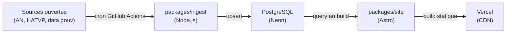

# Architecture

## Vue d'ensemble

Elupedia suit un pipeline linéaire : les données publiques sont collectées périodiquement, stockées en base, puis consommées au moment du build pour générer un site statique.

## Étapes du pipeline

### 1. Ingestion (`packages/ingest`)

Scripts Node.js (tsx) lancés par des DAGs **Dagu** (`dagu-dags/`, calendrier dans `docs/INGESTION-SCHEDULE.md`). Les anciens workflows cron GitHub Actions d'ingestion ont été retirés ; GitHub Actions ne sert plus qu'à la CI. Chaque script lit une ou plusieurs sources ouvertes (ZIP/JSON, CSV, API, scraping) et écrit en base par upsert.

- Exécution : un DAG Dagu par domaine (`ingest-an`, `ingest-senat`, `ingest-maires`, `ingest-conseillers-*`, `ingest-interests`, `ingest-press`, `ingest-press-maires`, `ingest-photos`, `ingest-maps`, `ingest-geocode`, `ingest-europe`, `ingest-factchecks`, `ingest-wikipedia`, `ingest-madada`, `ingest-hatvp-status`, `ingest-decorations`, `ingest-reconcile`, `ingest-social-links`, `ingest-membres-assemblee`)
- Déclenchement manuel : `yarn --cwd packages/ingest <script>` (liste complète dans `docs/INGEST.md`)
- Stratégie : upsert idempotent (insert on conflict update, ou select préalable + insert/update) ; un rejeu complet ne crée pas de doublons
- Résilience : `runStep` (voir `run-helpers.ts`) rejoue fetch + upsert jusqu'à 3 fois avec backoff (`utils/retry.ts`), isole les erreurs par étape et produit un résumé ; les sources qui tolèrent l'absence de données renvoient `[]`/`null` au lieu de lever (google-news, madada, hatvp-status, scraping) pour ne pas faire échouer un DAG entier
- Détection de changement : `utils/change-detector.ts` compare les compteurs `created`/`updated` et écrit `ingest-report*.json` à la racine du package ; un rebuild du site est déclenché si quelque chose a changé
- Orchestration : `run-*.ts` par domaine (ex. `run-an.ts` 8 étapes, `run-senat.ts` 9 étapes, `run-maires.ts` 5 étapes) ; `run.ts` enchaîne l'ensemble pour un run complet
- Points d'entrée : `main-*.ts` (un par script `package.json`), voir la convention ci-dessous et `docs/INGEST.md`

#### Clients de données

| Client                     | Fichier                            | Source                                     | Format        | Statut   |
| -------------------------- | ---------------------------------- | ------------------------------------------ | ------------- | -------- |
| Députés (tous)             | `sources/assemblee-nationale.ts`   | data.assemblee-nationale.fr                | ZIP/JSON      | ✅ actif |
| Collaborateurs AN          | `sources/an-collaborateurs.ts`     | data.assemblee-nationale.fr                | CSV           | ✅ actif |
| Adresses/contacts AN       | `sources/an-adresses.ts`           | data.assemblee-nationale.fr                | ZIP/JSON      | ✅ actif |
| Activité parlementaire     | `sources/an-activite.ts`           | data.assemblee-nationale.fr                | ZIP/JSON      | ✅ actif |
| Commissions/délégations    | `sources/an-commissions.ts`        | data.assemblee-nationale.fr                | ZIP/JSON      | ✅ actif |
| Intérêts (HATVP)           | `sources/hatvp.ts`                 | hatvp.fr                                   | XML streaming | ✅ actif |
| Sénateurs                  | `sources/senat.ts`                 | data.senat.fr                              | JSON API      | ✅ actif |
| Scrutins Sénat             | `sources/senat-scrutins.ts`        | data.senat.fr                              | JSON API      | ✅ actif |
| Groupes Sénat              | `sources/senat-groupes.ts`         | data.senat.fr                              | JSON API      | ✅ actif |
| Collaborateurs Sénat       | `sources/senat-collaborateurs.ts`  | data.senat.fr                              | JSON API      | ✅ actif |
| Adresses Sénat             | `sources/senat-adresses.ts`        | data.senat.fr                              | JSON API      | ✅ actif |
| Historique électoral Sénat | `sources/senat-elections.ts`       | data.senat.fr                              | JSON API      | ✅ actif |
| Commissions Sénat          | `sources/senat-commissions.ts`     | data.senat.fr                              | JSON API      | ✅ actif |
| Réseaux sociaux Sénat      | `sources/senat-reseaux-sociaux.ts` | senat.fr                                   | JSON + HTML   | ✅ actif |
| Scrutins AN                | `sources/an-scrutins.ts`           | data.assemblee-nationale.fr                | ZIP/JSON      | ✅ actif |
| Presse (Google News)       | `sources/google-news.ts`           | news.google.com                            | RSS/XML       | ✅ actif |
| Maires (RNE)               | `sources/rne-maires.ts`            | data.gouv.fr                               | CSV           | ✅ actif |
| Conseillers dép. (RNE)     | `sources/rne-conseillers-dep.ts`   | data.gouv.fr                               | CSV           | ✅ actif |
| Conseillers rég. (RNE)     | `sources/rne-conseillers-reg.ts`   | data.gouv.fr                               | CSV           | ✅ actif |
| Conseillers arr. (RNE)     | `sources/rne-conseillers-arr.ts`   | data.gouv.fr                               | CSV           | ✅ actif |
| Membres assemblée (RNE)    | `sources/rne-membres-assemblee.ts` | data.gouv.fr                               | CSV           | ✅ actif |
| Mairies (DILA)             | `sources/dila-mairies.ts`          | service-public.fr                          | JSON API      | ✅ actif |
| Parrainages présidentiels  | `sources/parrainages.ts`           | data.gouv.fr                               | CSV           | ✅ actif |
| Signatures RIP             | `sources/rip-signatures.ts`        | AN / Sénat                                 | HTML          | ✅ actif |
| Photos maires (Wikidata)   | `sources/wikidata-mayor-photos.ts` | query.wikidata.org + commons.wikimedia.org | SPARQL/JSON   | ✅ actif |
| Élections municipales      | `sources/municipal-elections.ts`   | data.gouv.fr                               | CSV streaming | ✅ actif |
| Élections législatives     | `sources/legislative-elections.ts` | data.gouv.fr                               | CSV streaming | ✅ actif |
| Élections sénatoriales     | `sources/senatorial-elections.ts`  | data.gouv.fr                               | CSV streaming | ✅ actif |
| Comptes de campagne CNCCFP | `sources/cnccfp.ts`                | data.gouv.fr                               | CSV           | ✅ actif |
| Statut HATVP (fiches)      | `sources/hatvp-status.ts`          | hatvp.fr                                   | HTML scraping | ✅ actif |
| Décorations (Légion d'h.)  | `sources/legion-honneur.ts`        | archives.legiondhonneur.fr                 | JSON API      | ✅ actif |
| Transparence (MaDada.fr)   | `sources/madada.ts`                | madada.fr                                  | JSON API      | ✅ actif |

#### Upsert / Diff

| Upsert                               | Fichier                             | Stratégie                                                                        |
| ------------------------------------ | ----------------------------------- | -------------------------------------------------------------------------------- |
| Officials + mandates (AN)            | `upsert/officials.ts`               | Upsert sur an_id                                                                 |
| Sénateurs + mandats                  | `upsert/senators.ts`                | Upsert sur an_id (source Sénat)                                                  |
| Votes + ballots (AN)                 | `upsert/an-votes.ts`                | Upsert sur ballot_id + official                                                  |
| Votes Sénat                          | `upsert/senat-votes.ts`             | Upsert sur ballot_id + official                                                  |
| Collaborateurs AN                    | `upsert/staffers-diff.ts`           | Diff (set end_date si parti)                                                     |
| Collaborateurs Sénat                 | `upsert/senat-staffers-diff.ts`     | Diff (set end_date si parti)                                                     |
| Affiliations AN                      | `upsert/affiliations-diff.ts`       | Diff (set end_date si changé)                                                    |
| Affiliations Sénat                   | `upsert/senat-affiliations.ts`      | Upsert sur official + groupe                                                     |
| Intérêts                             | `upsert/interests.ts`               | Upsert sur official + entity                                                     |
| Adresses AN                          | `upsert/addresses.ts`               | Upsert sur official + type                                                       |
| Adresses Sénat                       | `upsert/senat-addresses.ts`         | Upsert sur official + type                                                       |
| Activité parlementaire               | `upsert/parliamentary-activity.ts`  | Upsert sur official + title + date                                               |
| Commissions                          | `upsert/committees.ts`              | Upsert sur official + name + type                                                |
| Résultats électoraux AN              | `upsert/electoral-results.ts`       | Upsert sur official + election + round                                           |
| Résultats électoraux Sénat           | `upsert/senat-electoral-results.ts` | Upsert sur official + election + round                                           |
| Commissions Sénat                    | `upsert/senat-committees.ts`        | Upsert sur official + name + type                                                |
| Liens sociaux Sénat                  | `upsert/senat-social-links.ts`      | Upsert sur official + platform                                                   |
| Maires                               | `upsert/mayors.ts`                  | Upsert sur nom + prénom + naissance                                              |
| Conseillers départementaux           | `upsert/conseillers-dep.ts`         | Upsert sur nom + prénom + naissance ; fermeture par paire (canton, official)     |
| Conseillers régionaux                | `upsert/conseillers-reg.ts`         | Upsert sur nom + prénom + naissance ; fermeture par paire (section, official)    |
| Conseillers d'arrondissement         | `upsert/conseillers-arr.ts`         | Upsert sur nom + prénom + naissance ; fermeture par paire (secteur, official)    |
| Membres assemblée statut particulier | `upsert/membres-assemblee.ts`       | Upsert sur nom + prénom + naissance ; fermeture par paire (territoire, official) |
| Photos maires                        | `upsert/mayor-photos.ts`            | Match nom + commune (fallback naissance), skip si photo, rapport de synthèse     |
| Adresses mairies                     | `upsert/mayor-addresses.ts`         | Upsert sur official + town_hall                                                  |
| Scrape réseaux maires                | `upsert/mayor-social-scrape.ts`     | Scrape sites officiels communes                                                  |
| Mentions presse                      | `upsert/press-mentions.ts`          | Insert dédupliqué sur official + URL                                             |
| Parrainages                          | `upsert/sponsorships.ts`            | Batch insert, skip si existant                                                   |
| Photos S3                            | `upsert/upload-photos.ts`           | Download + upload S3, skip si existant                                           |
| Statuts HATVP                        | `upsert/hatvp-status.ts`            | Scrape fiches HATVP, set pending/null                                            |
| Élections municipales                | `upsert/municipal-elections.ts`     | Upsert sur commune + date + tour                                                 |
| Élections législatives               | `upsert/legislative-elections.ts`   | Upsert sur circo + date + tour                                                   |
| Élections sénatoriales               | `upsert/senatorial-elections.ts`    | Upsert sur département + date + tour                                             |
| Comptes de campagne                  | `upsert/campaign-accounts.ts`       | Upsert sur official + election                                                   |
| Décorations                          | `upsert/decorations.ts`             | Upsert sur arko_ref + order_name                                                 |
| Transparence commune                 | `upsert/commune-transparency.ts`    | Upsert sur commune_code                                                          |

### 2. Base de données (PostgreSQL / Neon)

Base PostgreSQL hébergée sur Neon (serverless). Le schéma est géré par Drizzle ORM et versionné via Drizzle Kit (migrations).

- Tables et colonnes en anglais, snake_case
- Schéma défini dans `packages/shared/src/schema/`
- Migrations dans `drizzle/`
- Client de connexion : `packages/shared/src/db.ts` (lit `DATABASE_URL`)

#### Tables (M0 — schéma)

| Table                    | Colonnes clés                                                                                                                                                      | FK vers                          |
| ------------------------ | ------------------------------------------------------------------------------------------------------------------------------------------------------------------ | -------------------------------- |
| `officials`              | id, first_name, last_name, an_id, slug (permalink unique), birth_date, death_date, photo_url, s3_photo_url, hatvp_status                                           | —                                |
| `mandates`               | type, district, department, start_date, end_date, political_group, commune_code, parent_commune_code                                                               | officials                        |
| `ballots`                | an_id, title, date, type                                                                                                                                           | —                                |
| `votes`                  | position (for/against/abstain/absent), seat_number                                                                                                                 | ballots, officials               |
| `ballot_group_positions` | organe_ref, group_name, position, member_count, votes_for/against/abstain/absent                                                                                   | ballots                          |
| `staffers`               | first_name, last_name, start_date, end_date (index sur official_id)                                                                                                | officials                        |
| `affiliations`           | party_or_group, start_date, end_date                                                                                                                               | officials                        |
| `interests`              | type (professional_activity/consulting_activity/governing_body_membership/voluntary_activity/elected_function/financial_participation), entity_name, declared_date | officials                        |
| `addresses`              | type (constituency/assembly), street, postal_code, city, phone, email                                                                                              | officials                        |
| `external_links`         | platform, url                                                                                                                                                      | officials                        |
| `press_mentions`         | title, source_name, source_url, published_date, summary                                                                                                            | officials                        |
| `parliamentary_activity` | type, title, date, status, question_text, response_text, response_date, government_comments, source_url, rubrique, tete_analyse, question_number                   | officials                        |
| `committees`             | name, type, start_date, end_date                                                                                                                                   | officials                        |
| `electoral_results`      | election_type, election_date, round, score_percent, opponent_count                                                                                                 | officials                        |
| `sponsorships`           | type, election_year, candidate_name, raw_elected_name, raw_function, publication_date, matched                                                                     | officials                        |
| `campaign_accounts`      | election_type, election_date, expenses_declared, expenses_retained, revenue_declared, donations_declared, reimbursement, decision                                  | officials                        |
| `declaration_snapshots`  | declaration_date, declaration_type, source_document_url                                                                                                            | officials                        |
| `municipal_elections`    | commune_code, commune_name, election_date, round, inscrits, abstentions, votants, blancs, nuls, exprimes                                                           | —                                |
| `municipal_candidates`   | panneau, nom, prenom, sexe, nuance, liste, voix, ratio_inscrits, ratio_exprimes                                                                                    | municipal_elections, officials   |
| `legislative_elections`  | circo_code, department, circo_name, election_date, round, inscrits, abstentions, votants, blancs, nuls, exprimes                                                   | —                                |
| `legislative_candidates` | panneau, nom, prenom, sexe, nuance, voix, ratio_inscrits, ratio_exprimes, elu                                                                                      | legislative_elections, officials |
| `senatorial_elections`   | department_code, department, election_date, round, inscrits, votants, blancs, nuls, exprimes, scrutin_type                                                         | —                                |
| `senatorial_candidates`  | nom, prenom, sexe, nuance, liste, voix, ratio_exprimes, elu                                                                                                        | senatorial_elections, officials  |
| `decorations`            | order_name, grade, decree_date, journal_officiel_date, ministry, quality, arko_ref                                                                                 | officials                        |
| `commune_transparency`   | commune_code (PK), madada_url_name, requests_count, requests_successful, requests_overdue, requests_not_held, updated_at                                           | —                                |

### 3. Build du site (`packages/site`)

Site Astro avec composants React et Tailwind CSS. Mode hybrid : pages statiques par défaut, SSR (server-side rendering via Vercel) pour les pages dynamiques (`prerender = false`).

- Framework : Astro 7 (output `static` avec opt-out SSR par page via `prerender = false`)
- Composants interactifs : React 19 (islands via `@astrojs/react`)
- Styling : Tailwind CSS 4 (via `@tailwindcss/vite`)
- Utilitaires date : date-fns (calcul d'âge sur la fiche élu)
- Layout de base : `src/layouts/BaseLayout.astro` (header, footer, meta description, titre dynamique)
- SEO : sitemap XML généré au build (`@astrojs/sitemap`), meta tags Open Graph (title, description, image, url, type, locale, site_name) avec images OG dynamiques (satori + resvg-js), URL canonique. JSON-LD schema.org enrichi sur toutes les pages : WebSite+Organization (BaseLayout), BreadcrumbList (annuaire, votes, fiche élu, fiche scrutin), ItemList (annuaire élus, listing votes), Person enrichi (fiche élu : `@id`, `honorificPrefix`, `gender`, `birthPlace`, `hasOccupation` avec tous les mandats, `memberOf` avec groupe politique + commissions actives, `affiliation` dédupliqué, `worksFor` GovernmentOrganization, `address` multiples, `sameAs`, `image` ImageObject, `knowsLanguage`, `deathDate`), VoteAction (fiche scrutin)
- oEmbed : endpoint `/api/oembed` conforme oEmbed 1.0 (JSON + XML), type `rich`, balises de découverte `<link rel="alternate">` sur fiches élus et scrutins, CORS ouvert. Permet aux CMS (WordPress, Ghost, Notion) d'afficher des cartes riches automatiquement. L'iframe pour les élus pointe vers `/elus/{slug}/embed` (carte compacte : photo, nom, rôle, date de début de mandat, lien vers la fiche)
- Images OG dynamiques : endpoints `/api/og/official/[slug].png`, `/api/og/scrutin/[id].png`, `/api/og/default.png`. Rendus via satori (JSX→SVG) + @resvg/resvg-js (SVG→PNG), police Inter, 1200×630 px, cache CDN 24h
- Site URL : `https://www.elupedia.fr`
- Consentement cookies : tarteaucitron.js vendorisé dans `public/tarteaucitron/`, conforme CNIL (highPrivacy, DenyAllCta, AcceptAllCta)
- Composants React : `src/components/OfficialsList.tsx` (grille d'accueil avec filtres : type de mandat, département, mandat actif), `src/components/QuestionDetailDrawer.tsx` (tiroir de détail d'une question), `src/components/InterestDetailDrawer.tsx` (tiroir de détail d'un intérêt), `src/components/TimelineDrawer.tsx` (chronologie complète), `src/components/MunicipalElectionDrawer.tsx` (résultats municipales), `src/components/JurisdictionMap.tsx` (carte de circonscription SVG), `src/components/HemicycleChart.tsx` (hémicycle interactif avec positions réelles AN, données dans `src/lib/hemicycle-seats.json`)
- Cartes statiques : les adresses des élus sont géocodées via l'API adresse du gouvernement (api-adresse.data.gouv.fr) à l'ingestion. Au build, des cartes statiques PNG sont générées avec la librairie `staticmaps` (tuiles OpenStreetMap), mises en cache sur disque via hash MD5 des coordonnées, et servies en remplacement de l'icône GPS. Crédit « © OpenStreetMap » affiché sur chaque carte. Lien vers OpenStreetMap au lieu de Google Maps
- Accessibilité : skip-to-content, focus-visible global, aria-label sur la navigation, contraste WCAG AA (minimum text-gray-500 pour le texte informatif)
- Pages :
  - `src/pages/index.astro` — page d'accueil (grille de cartes des élus avec photo, badge député/sénateur genré, nom, circonscription, groupe politique ; filtres par type de mandat et département)
  - `src/pages/elus/[slug]/index.astro` — fiche détaillée d'un élu, routée par slug permalink (`/elus/manuel-bompard`), avec fallback sur UUID si slug absent. Sections : identité avec âge calculé, mandat en cours, tous les mandats, coordonnées, affiliations, collaborateurs, activité parlementaire, commissions & groupes, historique électoral, intérêts déclarés groupés par catégorie, votes (avec lien vers page scrutin), presse (grille de cards Google News), liens extérieurs, indicateur de dernière mise à jour, modales de provenance AN pour les sections mandat/coordonnées/liens des députés
  - `src/pages/elus/[slug]/embed.astro` — carte embed compacte d'un élu (photo, nom, rôle, date début mandat, lien vers la fiche). Utilisée par l'iframe oEmbed
  - `src/pages/scrutins/[id].astro` — détail d'un scrutin (titre, date, type, barre de synthèse, hémicycle interactif avec positions réelles AN, panorama de vote par groupe avec consigne majoritaire, filtres par position et groupe politique, grille de cartes députés avec photo et badge de position). SEO : JSON-LD VoteAction + BreadcrumbList, og:type article, meta description avec décompte des votes
  - `src/pages/a-propos.astro` — page À propos (présentation, feuille de route, piliers, indépendance, contribution)
  - `src/pages/donnees-personnelles.astro` — page droits RGPD (données publiées, base légale, droits, contact, CNIL, cookies)
  - `src/pages/mentions-legales.astro` — mentions légales (sources de données, licences, hébergeur, licence code AGPL-3.0)
  - `src/pages/accessibilite.astro` — déclaration d'accessibilité RGAA 4.1 (état de conformité, mesures en place, contenus non accessibles, voie de recours)
  - `src/pages/docs/index.astro` — index de la documentation développeur
  - `src/pages/docs/oembed.astro` — documentation de l'endpoint oEmbed
  - `src/pages/docs/og-images.astro` — documentation des images Open Graph dynamiques
  - `src/pages/docs/commune-api.astro` — documentation de l'API Commune (élus par code INSEE)
- API endpoints :
  - `src/pages/api/oembed.ts` — endpoint oEmbed 1.0 (JSON + XML, CORS)
  - `src/pages/api/og/official/[slug].png.ts` — image OG dynamique pour un élu
  - `src/pages/api/og/scrutin/[id].png.ts` — image OG dynamique pour un scrutin
  - `src/pages/api/og/default.png.ts` — image OG par défaut
  - `src/pages/api/commune/[code].ts` — élus en exercice d'une commune par code INSEE (JSON)

### 4. Déploiement (Vercel)

Le site est déployé sur Vercel. Chaque push sur `main` déclenche un rebuild. Les pages SSR sont servies via Vercel Functions.

- Hébergement : Vercel (CDN mondial + serverless functions pour SSR)
- Mode : hybrid (statique par défaut, SSR pour les pages dynamiques via `@astrojs/vercel`)
- Configuration : `vercel.json` — `installCommand` active corepack pour Yarn 4, `buildCommand` lance `drizzle-kit migrate` puis `astro build` depuis `packages/site`, output dans `packages/site/dist`
- Domaine : `elupedia.fr` (DNS configuré vers Vercel)
- Variables d'environnement : `DATABASE_URL` configurée sur Vercel pour le build
- Analytics : Vercel Web Analytics (`@vercel/analytics`, cookieless, injecté dans le layout)
- Chaîne ingestion → rebuild : chaque workflow d'ingestion (AN, Sénat) expose `has_changes`, qui conditionne un rebuild Vercel via deploy hook

## Guide de lecture du code

Cette section résume les conventions qu'il faut connaître avant de plonger dans le code. Chaque fichier source porte en plus un commentaire d'en-tête (rôle, source des données, appelants, pièges).

### Convention `main-*.ts` / `run-*.ts` / `sources/` / `upsert/` (ingest)

| Couche                | Rôle                                                                                                                                                               | Règles                                                                                                        |
| --------------------- | ------------------------------------------------------------------------------------------------------------------------------------------------------------------ | ------------------------------------------------------------------------------------------------------------- |
| `main-<domaine>.ts`   | Point d'entrée CLI d'un script `package.json`. Parse les arguments (`cli.ts`), ouvre la connexion DB, appelle le `run-*`, écrit le rapport, fixe le code de sortie | Seul endroit qui fait `process.exit`                                                                          |
| `run-<domaine>.ts`    | Orchestration testable : enchaîne des étapes `runStep({ fetch, upsert })` et renvoie des `StepResult`                                                              | Ne fait jamais `process.exit` ; injectable (DB et fetch en paramètres) ; testé dans `run.test.ts`             |
| `sources/<source>.ts` | Lecture d'une source ouverte et conversion en objets typés. Aucune écriture en base                                                                                | Prend un `fetchFn` injectable ; documente le format brut et ses pièges                                        |
| `upsert/<table>.ts`   | Écriture en base à partir des objets des sources                                                                                                                   | Idempotent ; documente la clé de rapprochement, ce qui n'est jamais écrasé, et le sens de `created`/`updated` |
| `services/`, `utils/` | Briques transverses (géocodage, cartes statiques, retry, checkpoints, détection de changement)                                                                     |                                                                                                               |
| `filters/`            | Critères de l'ingestion AN partielle                                                                                                                               |                                                                                                               |

Dérogations documentées dans leur en-tête : `main-decorations`, `main-madada`, `main-parrainages`, `main-rip-signatures`, `main-photos` portent leur logique sans `run-*` ; `main-reconcile`, `main-dedupe-committees`, `main-check-coherence` sont des outils de maintenance.

### Contrat `StepResult` et compteurs

`runStep` rejoue fetch + upsert jusqu'à 3 fois : les upserts doivent donc être idempotents. `created`/`updated` sont des compteurs libres dont le sens varie par étape (certaines étapes rangent les lignes ignorées dans `updated`) ; chaque upsert documente la sémantique dans son en-tête. `change-detector` considère qu'il y a un changement dès qu'un compteur est > 0.

### Rapprochement des élus entre sources

Une personne est identifiée, dans l'ordre : par son identifiant source quand il existe (`officials.an_id`, `senat_id`, `europarl_id`), sinon par le triplet (prénom, nom, date de naissance) normalisé, sinon (Sénat uniquement) par le slug. Les sources RNE et les résultats électoraux n'ont que nom + prénom (± naissance) : les homonymes stricts sont un risque connu (voir `docs/KNOWN-ISSUES.md`). Pour les mandats, l'index unique `(official_id, type, start_date)` est la clé ; un mandat « en cours » côté source est d'abord cherché par date de début exacte, puis par statut actif (`upsert/officials.ts`).

### Historisation des mandats locaux (RNE)

Pour maires, conseillers (dép./rég./arr.), membres d'assemblée et AFE : si la date de prise de fonction du fichier est postérieure au mandat actif, on clôt l'ancien et on ouvre une nouvelle ligne ; si elle est antérieure, on corrige en place. Les titulaires disparus du fichier sont clos à la date du run. Une violation de l'index unique (code Postgres 23505) est absorbée. Le sens de `district`/`department`/`commune_code` dépend du type de mandat (secteur pour arrondissement, région + section pour les régionaux, libellé fixe pour les FDE) ; voir les en-têtes de `packages/shared/src/schema/mandates.ts` et des upserts concernés.

### Ce qui n'est jamais écrasé par une ingestion

Photos existantes (`mayor-photos`), coordonnées GPS déjà géocodées, `an_uid` des commissions, titres/URL des demandes MaDaDa, département connu d'un mandat quand la source n'a pas l'info, date de fin posée par une source plus à jour. Chaque cas est commenté à l'endroit où la règle s'applique.

### Fichiers annexes produits par l'ingestion

- `packages/ingest/ingest-report*.json` : rapports de run (compteurs par étape)
- `packages/ingest/madada-cache.json` : cache des réponses MaDaDa
- `~/.elupedia/checkpoints/` : reprises des ingestions longues (maires, adresses mairies)
- `data_provenance` : outre les provenances, sert de stockage de curseurs d'ingestion incrémentale (`source_table = 'europarl_questions_cursor'`, `'europarl_sittings'`)
- Colonnes/index ajoutés à la main en base hors drizzle-kit : `officials.press_checked_at`, `officials.factchecks_checked_at`, index `press_mentions_official_source_idx`

### Site : conventions à connaître

- **Rendu** : pages statiques (accueil, `/elus`, `/votes`, glossaire, pages légales) vs SSR avec `Cache-Control: s-maxage=3600, stale-while-revalidate=86400` (fiche élu, embed, scrutin, commission, élections). Les fiches élus acceptent un slug **ou** un UUID ; la comparaison à `officials.id` n'a lieu que si la valeur a la forme d'un UUID.
- **Directives `client:*`** : `client:load` pour l'interactif visible immédiatement, `client:idle` pour les tiroirs fermés par défaut, rien pour les SVG/HTML statiques (`JurisdictionMap`, `GlossaryExampleCard`).
- **Hydratation** : un composant qui lit `window`/l'URL doit faire son premier rendu sans la lire puis se synchroniser dans un effet (modèle : `OfficialsList`).
- **Événements DOM entre pages Astro et îlots React** : `open-question-detail`, `open-interest-detail`, `open-madada-drawer` (sur `window`, émis par la fiche élu) ; `dept-filter` (sur `document`, émis par `FranceDepartmentMap`, consommé par `scrutins/[id].astro`).
- **Query strings** : `OfficialsList` (`q,type,actif,photo,dep,groupe,tri,page`), `BallotsList` (`q,type,resultat,du,au,tri`), `ElectionPanorama` (`q` = commune, filtrage serveur).
- **Identifiants d'élections** : `YYYY..._tN` (fichiers OVH) pour municipales/législatives, `<année>-<tour>` pour les sénatoriales ; construits par `/elections/index`, consommés par `/elections/[type]/[id]`.
- **Commissions** : `committees` est une table d'adhésions sans table d'organes ; le slug de `/commissions/[slug]` est dérivé du nom via `slugifyText` et doit rester identique entre liens et page.
- **Thème sombre** : classe `.dark` sur `<html>`, clé localStorage `theme`, appliquée par un script inline de `BaseLayout` avant le premier rendu puis par `ThemeToggle`.
- **Cartes statiques** : clé MD5 de `lat_lon_zoom_WxH` (zoom 13, 400×200) partagée entre `packages/ingest/src/services/static-map.ts`, `upsert/upload-maps.ts` et la fiche élu (`MAPS_BASE_URL/maps/<md5>.png`). `packages/site/src/lib/static-map.ts` est un vestige sans appelant.
- **Images OG** : satori n'accepte que flexbox (`display:flex` obligatoire sur chaque conteneur), polices Inter téléchargées au premier rendu, logo inliné en base64 car `public/` n'est pas dans le bundle serverless.
- **Libellés de groupes** : `POLITICAL_GROUP_COLORS`/`URLS` font une correspondance stricte sur la chaîne « Nom (SIGLE) » ; un renommage à la source fait perdre couleur et lien silencieusement.
- **`slugifyText`** produit des URLs publiques (`/elus/{slug}`, `/commissions/{slug}`) : toute modification est un changement d'URL.

### Tests qui lisent le code source

Les tests racine (`tests/site-*.test.js`, `embed-card`, `oembed`, `og-image`, `commune-api`, `schema`, `site-db`…) et certains tests de composants ouvrent les fichiers source et vérifient des chaînes exactes (noms de variables comme `deputy.firstName` ou `v.ballotTitle`, blocs de code, absence du mot `BaseLayout` dans `embed.astro`). Avant un refactor, lancer `yarn vitest run` à la racine ; les fichiers concernés le signalent dans leur en-tête.

## Packages partagés (`packages/shared`)

Contient le client DB (Drizzle + Neon), le schéma complet, les types TypeScript et les helpers utilisés à la fois par `ingest` et `site`.

## Documentation et conformité

- **README.md** : présentation du projet, stack, sources de données, instructions de setup, contribution, badge CI
- **LICENSE** : texte complet AGPL-3.0
- **docs/DATA-LICENSES.md** : inventaire des sources de données et leurs licences de réutilisation
- **docs/ARCHITECTURE.md** : ce fichier
- **docs/DOMAINS.md** : domaines métier et sources associées
- **docs/INGEST.md** : scripts d'ingestion et leurs options
- **docs/INGESTION-SCHEDULE.md** : calendrier des DAGs Dagu
- **docs/KNOWN-ISSUES.md** : anomalies et dettes connues, repérées à la lecture du code

## CI / CD

- **GitHub Actions CI** (`.github/workflows/ci.yml`) : lint, format, typecheck et tests sur chaque PR et push sur `main`
- **Ingestion** : DAGs Dagu (`dagu-dags/`), plus de cron GitHub Actions d'ingestion ; calendrier dans `docs/INGESTION-SCHEDULE.md`
- **Dependabot** (`.github/dependabot.yml`) : surveillance hebdomadaire des dépendances npm

## Dépendance externe : Bursae (fiche budgétaire communale)

Seule brique du site alimentée en direct par un service tiers au moment du rendu, et non par une ingestion en base.

- **Ce qui est consommé** : l'endpoint oEmbed de Bursae, `https://www.bursae.fr/api/oembed?url=<url>&format=json`. La réponse contient une iframe servie et rendue par Bursae. Aucune donnée budgétaire n'est copiée ni stockée chez nous.
- **Client** : `packages/site/src/lib/bursae.ts`. Affiché par la section « Finances communales » de `/elus/[slug]`, pour les maires uniquement.
- **Clé de correspondance** : le **code INSEE**, via `https://bursae.fr/collectivite/insee/{code}`. Ne jamais revenir au slug de nom : 4 369 communes sur 46 416 partagent leur slug avec une autre, et Bursae répond alors 409. La réponse porte `code_insee`, qui permet de vérifier la collectivité obtenue.
- **Origine surchargeable** : la variable d'environnement `BURSAE_ORIGIN` remplace l'hôte appelé — utile pour tester une indisponibilité, ou pour couper la dépendance sans redéployer le code.

### Comportement en cas de défaillance

`fetchBursaeEmbed` ne lève jamais et renvoie `null` dans tous les cas dégradés. La section disparaît alors de la fiche ; rien d'autre n'est affecté.

- **Temps de rendu** : plafonné par un timeout de 2 s (`AbortSignal.timeout`). Mesuré sur une adresse non routable : `null` rendu en 2 014 ms, puis mis en cache. Une fiche maire dont la commune est couverte se rend en ~1,5 s, soit le temps d'une fiche de député sans appel externe.
- **Build** : aucun impact. Les fiches élu sont en `prerender = false` ; aucun appel à Bursae n'a lieu à la construction du site.
- **Référencement** : la section est rendue côté serveur. Si Bursae ne répond pas, la page est servie complète sans cette section — jamais une page en erreur ni un bloc vide.
- **Cache** : 24 h pour une fiche obtenue, 1 h pour une absence. Une panne de Bursae n'est donc retentée qu'une fois par heure et par commune.

### Journalisation

Les échecs sont écrits sur la sortie d'erreur, préfixés `[bursae]`, avec le code INSEE concerné :

| Niveau  | Motif          | Signification                                                                                             |
| ------- | -------------- | --------------------------------------------------------------------------------------------------------- |
| `error` | `contrat`      | Réponse 200 mais illisible : **rupture de contrat côté Bursae**, le seul cas qui demande une intervention |
| `warn`  | `indisponible` | HTTP 5xx                                                                                                  |
| `warn`  | `timeout`      | Pas de réponse en 2 s                                                                                     |
| `warn`  | `réseau`       | DNS, connexion, JSON invalide                                                                             |

Une commune absente du référentiel Bursae (404) ou un slug ambigu (409) ne sont **pas** journalisés : ce sont des réponses normales, et les confondre avec des incidents rendrait les journaux inexploitables.

### Si le contrat change

Un `[bursae] contrat` dans les journaux signale que la réponse n'est plus exploitable — champ `type` modifié, `html` disparu ou sans iframe. Marche à suivre : vérifier la réponse réelle de l'endpoint, adapter `parseOembed` dans `packages/site/src/lib/bursae.ts`, ouvrir un ticket sur MathRobin/bursae si le changement est involontaire. En attendant, la section reste simplement masquée. Pour couper la dépendance immédiatement, pointer `BURSAE_ORIGIN` vers une origine inexistante.

## Tests

- **Framework** : Vitest (configuré à la racine et dans chaque package)
- **Commande** : `yarn test` lance les tests racine puis ceux de chaque workspace
- **Couverture M7** : structure monorepo, configs, schéma DB, migration, CI, clients API (ZIP/JSON et CSV), upsert/diff, retry, orchestration, cron workflow, change detection, layout, tarteaucitron, SEO, Vercel Web Analytics, page d'accueil, fiche élu avec 14 sections et âge calculé, page scrutin, page à propos, page RGPD, page mentions légales, accessibilité, README, DATA-LICENSES
